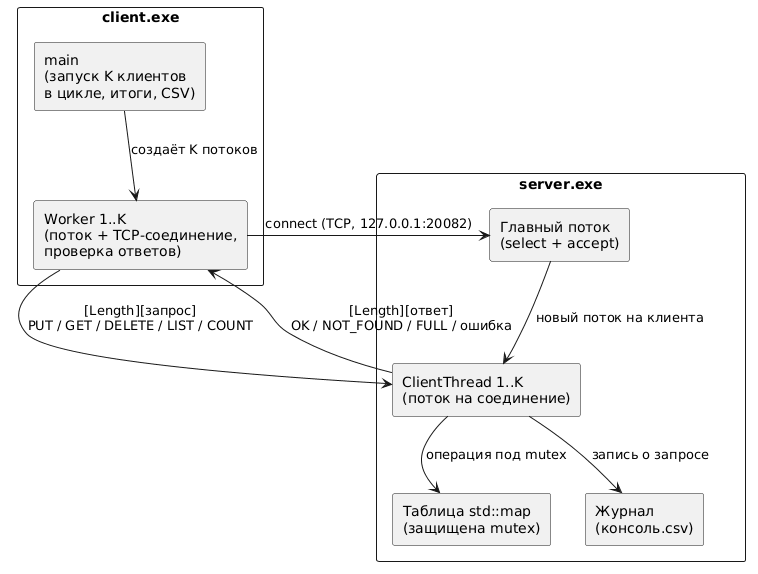
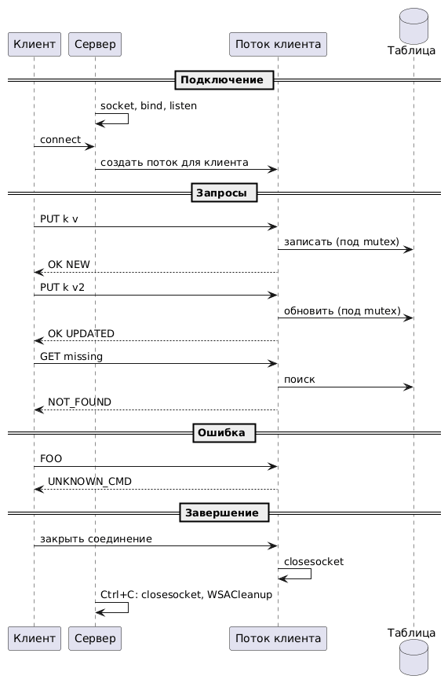

# Лабораторная работа №5
## Элементы сетевого программирования

## Вариант 20: Сетевая служба хранения пар «ключ–значение»

Клиент-серверное приложение на Windows Sockets (TCP). Сервер хранит таблицу "ключ–значение" в оперативной памяти и обслуживает несколько клиентов одновременно: для каждого соединения создаётся отдельный поток, доступ к общей таблице защищён `mutex`.
Поддержаны операции `PUT`, `GET`, `DELETE`, `LIST`, `COUNT`.
Клиент запускает K независимых клиентов (поток и TCP-соединение на каждого), выполняет случайную последовательность операций и проверяет все ответы сервера: изменение существующего ключа, отсутствие ключа, конкурентные обновления одной записи.
Сервер записывает в CSV каждый обработанный запрос (команда, результат, размеры, время обработки), по этим данным строятся графики.

## Требования к среде выполнения

- ОС: Windows (выполнение проводилось в системе Windows 11)
- Компилятор: MSVC (сборка в среде выполнения Visual Studio), C++17
- Python 3 с `pandas` и `matplotlib` для графиков (`plots/performance.ipynb`)
- PlantUML для пересборки диаграмм из `scripts/*.puml`

## Протокол

Транспорт: TCP. Адрес по умолчанию `127.0.0.1` (localhost), порт задается номером студака.

Сообщение: `[Length: 4 байта, сетевой порядок][Payload: Length байт, текст]`. Длина 0 или больше 65536 считается ошибкой: сервер отвечает `BAD_LENGTH` и закрывает соединение. Частичные `send()` и `recv()` обрабатываются в циклах.

- запрос: `<ver> <reqId> <clientId> <CMD> [аргументы]`
- ответ: `<ver> <reqId> <status> [данные]`

Ограничения: ключ до 32 символов без пробелов, значение до 256 символов (может содержать пробелы), версия протокола 1.

| Команда | Запрос | Ответ при успехе | Другие ответы |
|---------|--------|------------------|---------------|
| `PUT` | `PUT key value` | `OK NEW` (создан) или `OK UPDATED` (изменён) | `FULL` (таблица содержит 1000 записей) |
| `GET` | `GET key` | `OK value` | `NOT_FOUND` |
| `DELETE` | `DELETE key` | `OK` | `NOT_FOUND` |
| `LIST` | `LIST` | `OK key1 key2 ...` | `...` |
| `COUNT` | `COUNT` | `OK n` | `...` |

## Параметры запуска

### Сервер

| Параметр | Описание | Значение по умолчанию |
|----------|----------|-----------------------|
| `--host` | IPv4-адрес прослушивания | `127.0.0.1` |
| `--port` | номер порта | 20082 |
| `--timeout-ms` | максимальное ожидание следующего запроса от клиента (таймаут), мс | 30000 |
| `--csv` | файл, в который дописывается строка на каждый запрос | файл не записывается |
| `--verbose` | вывод каждого запроса в консоль (0 или 1) | 0 |

### Клиент

| Параметр | Описание | Значение по умолчанию |
|----------|----------|-----------------------|
| `--host` | IPv4-адрес сервера | `127.0.0.1` |
| `--port` | номер порта | 20082 |
| `--clients` | число одновременно работающих клиентов (1–60) | 1 |
| `--ops` | число операций на каждого клиента | 100 |
| `--keys` | число собственных ключей на клиента | 20 |
| `--timeout-ms` | максимальное ожидание ответа, мс | 5000 |
| `--delay-ms` | пауза между запросами одного клиента, мс | 20 |
| `--seed` | начальное значение генератора случайных чисел | 8954 (`1000 + STUDENT_ID * 97`) |
| `--cmd` | отправить один запрос и вывести ответ (для ручных проверок) | |

### Пример запуска:
```bash
server.exe --csv data/k3_ops100.csv
client.exe --clients 3 --ops 100
```
Сервер останавливается по Ctrl+C: он закрывает соединения, сбрасывает данные в CSV и выводит итоги (соединения, запросы, отклонённые запросы).

## Формат CSV сервера

Строка на каждый запрос (запись идёт в порядке завершения запросов, перед анализом сортируйте по `t_ms`):

| Колонка | Описание |
|---------|----------|
| `time` | время обработки |
| `t_ms` | время получения запроса, мс от старта сервера |
| `conn`, `client_id`, `req_id` | соединение, клиент, номер запроса |
| `cmd`, `key` | команда и ключ |
| `status` | результат (`OK`, `NOT_FOUND`, `FULL`, ошибки протокола) |
| `detail` | для `PUT`: `NEW` или `UPDATED` |
| `bytes_in`, `bytes_out` | размеры запроса и ответа, байт |
| `proc_us` | время обработки запроса сервером (без сети), мкс |
| `total_us` | от получения запроса до отправки ответа, мкс |
| `entries` | размер таблицы после операции (-1, если запрос отклонён до обращения к ней) |
| `active_conns` | число подключённых клиентов |

## Проведение эксперимента

1. Конфигурации: 1 и 3 клиента, 100 и 500 операций на клиента, по **3** запуска каждой конфигурации. Для каждой конфигурации сервер запускается отдельно со своим файлом:
```bash
server.exe --csv data/k1_ops100.csv
client.exe --clients 1 --ops 100
```
```bash
server.exe --csv data/k3_ops100.csv
client.exe --clients 3 --ops 100
```
```bash
server.exe --csv data/k1_ops500.csv
client.exe --clients 1 --ops 500
```
```bash
server.exe --csv data/k3_ops500.csv
client.exe --clients 3 --ops 500
```
2. Эксперимент со своим идентификатором: `STUDENT_ID = 82`, порт `20082`, `SEED = 1000 + STUDENT_ID * 97 = 8954` (значения по умолчанию).
3. Ручные проверки обработки ошибок:
```bash
client.exe --cmd "PUT a hello world"
client.exe --cmd "GET missing"
client.exe --cmd "FOO"
client.exe --port 20999 --cmd "COUNT"
```
Последняя команда демонстрирует недоступность сервера (код ошибки Winsock и его описание).
4. Графики строятся в `plots/performance.ipynb` по CSV из `data/`.

## Структура репозитория

```
lab05-network/
├── vspart/                     исходный код проекта
|     ├── ServerSide/Main.cpp   код серверной части
|     └── ClientSide/Main.cpp   код клиентской части
├── data/                       исходные данные экспериментов (CSV сервера)
├── plots/                      performance.ipynb: построение графиков
├── scripts/                    architecture.puml, sequence.puml (исходники диаграмм PlantUML)
├── images/                     architecture.png, sequence.png (готовые диаграммы)
└── README.md
```

## Диаграммы



